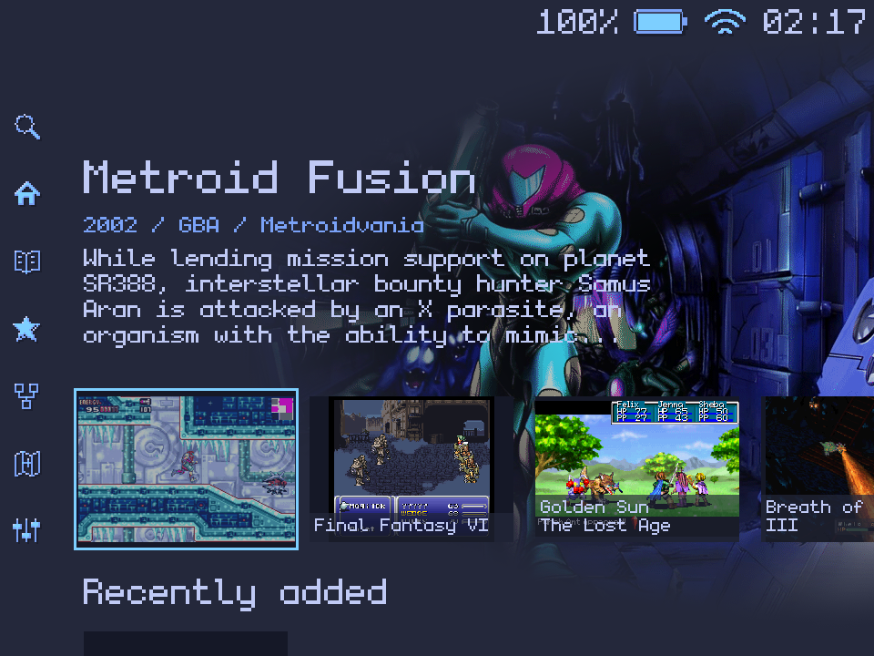

# MinPocket

A fast, game-focused Linux experience for the **MiniLoong Pocket 1**.

MinPocket brings a native C interface, pixel-art styling and a small operating
system together around one goal: making it easier to choose something to play.



## Features

- **Game-focused Home.** Browse artwork cards with selected-game information,
  full-screen backgrounds and animated navigation.
- **Native pixel interface.** Monogram typography, Tokyo Night Storm colors,
  authored icons and consistent layout and motion.
- **Live status.** Battery level and charging animation, Wi-Fi signal strength
  and a 24-hour clock.
- **Fast startup.** A tailored boot path and saved-Home cache prioritize the
  first displayed frame. Background services start after the initial frames.
- **Efficient artwork.** Prepared image derivatives, bounded RAM caching and
  parallel LZ4 compression reduce repeated work while preserving original media.
- **Hardware-focused design.** Direct DRM presentation, physical controls and
  60 Hz operation on the MP1's 960 × 720 display.

The sidebar brings together **Search, Home, Library, Favorites, Collections,
Discovery and Settings**. Display and power controls live inside Settings.

## Architecture

| Layer | Implementation |
|---|---|
| Boot | U-Boot, bounded FIT loading and saved-Home handoff |
| System | Buildroot, musl and a native C launcher running as PID 1 |
| Display | Direct DRM presentation with ordered drawing layers |
| Interface | Reusable layout, styling, animation and indicator components |
| Storage | exFAT Data partition, runtime library and persistent asset cache |

## Build

On Linux, install a C compiler, Make, Python 3, pkg-config and libdrm development
headers, then run:

```sh
make native
```

Executables are written to `build/native/`. The launcher targets the MP1's
kernel, display and input integration and runs as PID 1.

For the Buildroot userspace archive:

```sh
./production/build-rootfs.sh
```

This command requires Docker, curl and a SHA-256 utility. It verifies the pinned
Buildroot download and writes its output to `build/buildroot/`. Boot integration
uses the matching MP1 kernel, device tree and firmware sources.

## Roadmap

- Game launching, save states and resume.
- Library search, favorites, collections, discovery and recently added indexing.
- ScreenScraper integration for artwork and game information.
- Complete board-source packaging and SD-image builds.

## Contributing

```sh
make check
make audit
make setup-hooks
```

Component checks cover rendering, layout, navigation, animation, cache recovery
and boot-cache framing. The source audit also runs through the commit and push
hooks. GitHub Actions checks source changes, component tests and userspace builds.

| Directory | Contents |
|---|---|
| `native/` | Launcher, framework, device integration and component tests |
| `boot/` | FIT loader, cache handoff and U-Boot modifications |
| `design/` | Theme tokens, selected icons and layout compilers |
| `production/` | Buildroot package, MP1 configuration and kernel modifications |
| `scripts/` | Source audit and build helpers |

## License

The launcher uses **GPL-2.0-only**. Individual boot components also identify
**GPL-2.0-or-later** in their headers. See [LICENSE](LICENSE) and
[THIRD_PARTY.md](THIRD_PARTY.md) for the font and codec licenses.

Game artwork shown in the documentation retains its respective owners'
copyrights. The source-code license does not cover that artwork.
